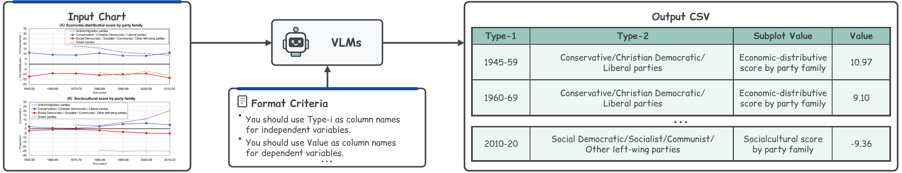

# Chart2CSV Task Workflow

Chart2CSV evaluates whether vision-language models (VLMs) can faithfully convert
a chart taken from a research paper into a structured table (CSV).



## Task

Given a single chart image, a model must extract every data point and output a
CSV that reproduces the chart's underlying table.

1. **Input** — a chart image: a plot (`P-*`) or a table (`T-*`).
2. **Convert** — a VLM reads the chart and generates a CSV.
3. **Evaluate** — the generated CSV is scored against the human-verified
   ground-truth CSV (plot precision for plots, cell accuracy for tables).

## Repository layout

Each numbered folder corresponds to one source figure and holds its chart
instances paired with ground-truth CSVs:

```
<id>/
  P-<id>-O<k>.{png,jpg,jpeg,webp}   # plot chart image
  P-<id>-O<k>.csv                   # ground-truth CSV for that plot
  T-<id>-O<k>.{png,jpg}             # table chart image
  T-<id>-O<k>.csv                   # ground-truth CSV for that table
```

- `P-` denotes a plot chart and `T-` denotes a table chart.
- `-O<k>` indexes the individual charts extracted from the same source figure
  (e.g. `P-116-O3A` / `P-116-O3B` for sub-panels of one figure).
